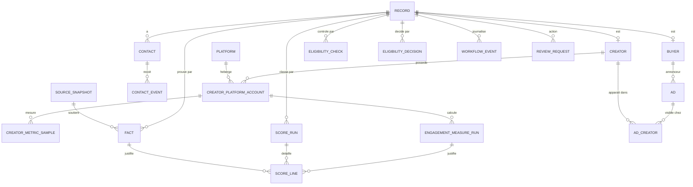

# Modèle de données — fiches créateur et acheteur

> Statut : proposition v1.2 — 16 novembre 2026  
> Références : `docs/scope.md` v1.4, `docs/scoring.md`, `docs/engagement.md`, `docs/verification.md`, `docs/pipeline.md`  
> Fichiers : `db/baserow/schema.json`, `db/postgres/001_schema.sql`, `db/postgres/002_seed_reference.sql`

## 1. Décision : deux couches, une seule vérité par champ

Le dispositif sépare volontairement deux usages qui n'ont ni le même rythme, ni
les mêmes exigences :

| Besoin | Baserow | PostgreSQL |
|---|---|---|
| Voir et filtrer les fiches | oui, interface principale | non |
| Saisir une publicité, un contact, une preuve | oui | reçoit et canonicalise |
| Affecter, annoter, demander une revue | oui | journalise la décision |
| Identifiants fiscaux, handles, URLs normalisées | affichage seulement | **source de vérité** |
| Faits, sources, dates, niveaux de preuve | affichage seulement | **source de vérité** |
| Scores et décomposition point par point | affichage seulement | **source de vérité** |
| Éligibilité et contrôles réglementaires | affichage seulement | **source de vérité** |
| Contacts, opt-out, historique de prospection | saisie et lecture | **source de vérité** |
| Journal des décisions, audit, synchronisation | lecture | **source de vérité** |

PostgreSQL est justifié dès maintenant, et pas seulement « si les besoins le
justifient », pour cinq raisons déjà écrites dans le cadrage :

1. **La provenance est obligatoire.** Un fait sans source et sans date n'est pas
   une fiche (P-03). Cela demande des tables de sources, de snapshots et de faits,
   pas une colonne texte dans un tableur.
2. **Le score doit être rejouable.** Mêmes faits et même version de critères
   doivent donner le même résultat (Q-05), et chaque point doit être rattaché au
   fait qui le justifie (Q-06). Un simple champ « score » ne le permet pas.
3. **L'éligibilité n'est pas un score.** Elle a quatre valeurs distinctes et des
   contrôles datés (RKN, licence de paris, sanctions, agent étranger). Elle doit
   conserver la raison d'un refus, même quand le fait est établi.
4. **L'opposition est définitive.** Un opt-out doit bloquer la fiche entière et
   laisser une trace exploitable (K-03), pas seulement changer une couleur dans
   une vue.
5. **Le dédoublonnage est une règle métier.** INN/OGRN, handles normalisés,
   fusions de fiches et historiques de fusion demandent des contraintes que
   Baserow ne sait pas porter.

Baserow reste l'endroit où l'on travaille : files de revue, saisie des
publicités, ajout de preuves, contacts, demandes d'action. Il ne décide ni un
score, ni une éligibilité, ni une fusion.

## 2. Principes non négociables

| Principe | Conséquence dans le schéma |
|---|---|
| **Une seule vérité par champ** | Chaque champ a un propriétaire `PG`, `BR` ou `D`. Aucun champ n'est éditable des deux côtés. |
| **Identifiants stables** | `record_id` (UUID) et `reference` (`CR-…` / `BY-…`) ne changent jamais. Un handle ou un nom peut changer. |
| **Aucune suppression** | Un doublon est fusionné (`merged_into`), une fiche écartée garde son statut. L'historique reste lisible. |
| **Preuve avant valeur** | Un fait pointe vers un snapshot de source daté. Une correction crée un nouveau fait. |
| **Statut et éligibilité séparés** | `workflow_status` décrit le parcours ; `eligibility_status` décrit le droit. Un score élevé ne rattrape jamais une éligibilité manquante (H-04). |
| **Dédoublonnage par identité** | INN/OGRN pour les acheteurs ; plateforme + handle normalisé pour les créateurs. Le nom n'est qu'un contrôle croisé. |
| **Versionnement** | Chaque classement et chaque décision portent une `criteria_version`. Une modification de seuil crée une nouvelle version (V-01). |
| **Lecture seule par défaut** | Ce qui est calculé ou vérifié côté PostgreSQL n'est pas réécrit dans Baserow. Une correction passe par une preuve ou une action de revue. |

## 3. Identifiants et conventions

| Élément | Convention | Exemple |
|---|---|---|
| Fiche | UUID PostgreSQL, jamais réutilisé | `9f1c…` |
| Référence lisible | `CR-` + 6 chiffres, `BY-` + 6 chiffres | `CR-000123` |
| Profil de plateforme | `platform_id` + `normalized_handle` | `VK Video` + `red` |
| URL | minuscules, `www` et barre finale retirés, paramètres de tracking supprimés | `vk.com/red` |
| Acheteur | INN validé, sinon OGRN validé, sinon repli nom normalisé + région/domaine | `7707083893` |
| Nom juridique | forme normalisée pour la comparaison, valeur brute conservée | `ооо тест` / `ООО «Тест»` |
| Publicité | URL normalisée + `erid` (ou `creative_ref` à défaut) | `…/123` + `erid` |
| Lien Baserow | `(entity_type, entity_id, baserow_table_id, baserow_row_id)` | table `Createurs`, ligne `42` |

Les champs `platform_username` et `platform_account_id` ne sont pas des clefs de
dédoublonnage : le premier est modifiable, le second peut manquer. La clef
créateur est `plateforme + identifiant normalisé`, avec l'URL normalisée comme
clef de secours (§3.4 et `verification.md` §2.5).

## 4. Modèle Baserow — interface de travail

### 4.1 Vue d'ensemble

| Table | Rôle | Cardinalité utile |
|---|---|---|
| `Createurs` | fiche créateur, une par entité | 1 créateur → N profils |
| `Acheteurs` | fiche acheteur, une par personne morale | 1 acheteur → N contacts, N publicités |
| `Profils_plateforme` | comptes d'un créateur | N profils → 1 créateur |
| `Contacts` | contacts professionnels publics | 1 fiche → N contacts |
| `Publicites_etiquetees` | étiquettes publicitaires brutes | 1 publicité → 1 acheteur, N créateurs |
| `Preuves` | faits et preuves, append-only | 1 fiche → N preuves |
| `Decisions` | journal des décisions, lecture seule | 1 fiche → N décisions |
| `Plateformes` | référentiel RKN et contraintes de campagne | référentiel |

Le fichier `db/baserow/schema.json` porte le détail machine : types Baserow,
options des listes, tables liées, champs calculés et propriétaire.

Légende des propriétaires :

- **PG** : écrit par PostgreSQL, lecture seule dans Baserow.
- **BR** : saisi ou modifié dans Baserow, remonté à PostgreSQL.
- **D** : dérivé (formula, lookup, count), jamais saisi.

> `required` est un contrat du projet. Baserow n'impose pas la nullité au niveau
> du champ ; les formulaires et le service de synchronisation la valident.

### 4.2 Fiche `Createurs`

#### Identité et parcours

| Champ | Type Baserow | Obligatoire | Propriétaire | Rôle |
|---|---|---|---|---|
| `display_name` | text | oui | PG | nom affiché |
| `reference` | text | oui | PG | `CR-000123` |
| `record_id` | text | oui | PG | UUID, clef de synchronisation |
| `workflow_status` | single_select | oui | PG | statut du parcours |
| `eligibility_status` | single_select | non | PG | vide tant que non décidé |
| `score` | number | non | PG | score entier /100 |
| `score_total_exact` | text | non | PG | total exact avant troncature |
| `score_incomplete` | boolean | non | PG | au moins une mesure inconnue (S-03) |
| `score_proposal` | single_select | non | PG | `PRESELECTED`, `REJECTED`, `TO_REVIEW`, `QUALIFIED` |
| `score_bounds_lower` | text | non | PG | borne basse quand une mesure manque |
| `score_bounds_upper` | text | non | PG | borne haute quand une mesure manque |
| `criteria_version` | text | oui | PG | version du dernier classement |
| `assigned_to` | text | non | BR | analyste responsable |
| `tags` | multiple_select | non | BR | étiquettes de travail |
| `notes` | long_text | non | BR | notes, jamais une preuve |
| `review_action` | single_select | non | BR | action demandée |
| `review_action_note` | long_text | non | BR | justification |
| `review_action_at` | date_time | non | BR | date de la demande |
| `review_action_processed` | boolean | non | PG | action appliquée ? |

`review_action` est une **intention**, pas un statut. PostgreSQL valide la
transition, écrit `workflow_event`, puis repousse le nouveau `workflow_status`.
Les valeurs proposées : `REQUEST_REVIEW`, `APPROVE`, `REJECT`,
`COMPLIANCE_REVIEW`, `START_AUDIT`, `ADD_TO_POOL`, `MARK_CONTACTED`,
`RECORD_OPT_OUT`.

#### Profil principal et audience

| Champ | Type Baserow | Obligatoire | Propriétaire | Rôle |
|---|---|---|---|---|
| `main_platform` | link_row → `Plateformes` | oui | PG | plateforme principale |
| `handle` | text | oui | PG | handle normalisé |
| `platform_url` | url | oui | PG | URL normalisée |
| `platform_account_id` | text | oui | PG | identifiant stable, peut manquer |
| `platform_username` | text | oui | PG | nom affiché, modifiable |
| `platform_coverage_status` | single_select | oui | PG | `COVERED` / `NOT_COVERED` / `UNKNOWN` |
| `coverage_checked_at` | date_time | oui | PG | date du contrôle |
| `followers` | number | oui | PG | abonnés |
| `followers_read_at` | date_time | oui | PG | date de lecture |
| `engagement_status` | single_select | oui | PG | `MEASURED` / `UNKNOWN` (C-03) |
| `engagement_measure` | single_select | conditionnel | PG | `VIEWS_PER_ITEM` / `CONCURRENT_VIEWERS` |
| `engagement_statistic` | single_select | conditionnel | PG | `MEDIAN` |
| `engagement_value` | number | conditionnel | PG | médiane des vues ou des simultanés |
| `engagement_sample_size` | number | conditionnel | PG | éléments lisibles retenus |
| `engagement_unreadable_count` | number | non | PG | éléments illisibles dans la fenêtre |
| `engagement_window` | text | conditionnel | PG | fenêtre réellement utilisée, dates et mode |
| `engagement_read_at` | date_time | conditionnel | PG | instantané de lecture |
| `engagement_sample_ref` | long_text | non | PG | échantillon conservé ou référence PostgreSQL |
| `engagement_flag` | multiple_select | non | PG | `WEAK_SAMPLE`, `WINDOW_EXTENDED`, `DISPERSION`, `UNREADABLE` |
| `average_views` | number | non | PG | moyenne de diagnostic, ne note pas |
| `average_concurrent_viewers` | number | non | PG | moyenne de diagnostic, ne note pas |
| `published_last_30_days` | number | oui | PG | publications sur 30 jours |
| `last_published_at` | date_time | oui | PG | dernière publication |
| `profiles` | link_row → `Profils_plateforme` | non | PG | tous les comptes |
| `other_profiles` | long_text | non | PG | URL des profils secondaires |
| `country` | text | oui | PG | ISO 3166-1 alpha-2 |
| `content_language` | text | oui | PG | ISO 639-1 |
| `gaming_share` | number | oui | PG | part gaming, en pourcentage de 0 à 100 |

`conditionnel` signifie : obligatoire quand `engagement_status = MEASURED`, vide
quand il vaut `UNKNOWN`. Le service de synchronisation applique la condition ;
Baserow ne sait pas l'exprimer au niveau du champ.

`platform_account_id` figure au contrat, mais peut rester vide quand la
plateforme n'expose pas d'identifiant stable. Ce vide est justifié par
`platform_coverage_status` et les notes du référentiel ; il ne doit pas, à lui
seul, faire rejeter la fiche (`verification.md` §2.5).

#### Vérification RKN et contrôles

| Champ | Type Baserow | Obligatoire | Propriétaire | Rôle |
|---|---|---|---|---|
| `rkn_registry_url` | url | oui | PG | lien publié par le créateur |
| `rkn_search_status` | single_select | oui | PG | `FOUND`, `NOT_FOUND`, `SEARCH_UNAVAILABLE`, `MANUAL_REVIEW` |
| `rkn_search_query` | text | oui | PG | requête exacte |
| `rkn_registry_status` | single_select | oui | PG | `VERIFIED`, `PARTIAL`, `PENDING`, `MISMATCH`, `NOT_FOUND`, `NOT_APPLICABLE`, `MANUAL_REVIEW` |
| `registry_domain_ok` | boolean | oui | PG | domaine présent dans la source officielle |
| `registry_url_match` | boolean | oui | PG | URL identique à l'inscription |
| `a_plus_badge` | boolean | oui | PG | badge observé |
| `creator_control_verified` | boolean | oui | PG | contrôle du compte effectué |
| `foreign_agent_label` | boolean | oui | PG | étiquette d'agent étranger |
| `ad_contact_or_rate_card` | boolean | oui | PG | contact publicitaire ou grille |
| `past_labeled_ads` | boolean | oui | PG | publicités étiquetées passées |
| `platform_risk` | lookup | non | D | risque lu dans `Plateformes` |
| `platform_campaign_allowed_until` | lookup | non | D | date limite de campagne |

`platform_risk` n'est pas saisi : il vient de la plateforme principale. Une
plateforme Telegram ou YouTube porte une date limite, pas un rejet silencieux.

#### Éligibilité, contact et sources

| Champ | Type Baserow | Obligatoire | Propriétaire | Rôle |
|---|---|---|---|---|
| `verification_date` | date | oui | PG | dernière vérification |
| `verification_evidence` | long_text | oui | PG | de quoi refaire le contrôle |
| `verification_evidence_url` | url | non | PG | snapshot côté PostgreSQL |
| `contact_channel` | single_select | oui | PG | canal public prioritaire |
| `source_refs` | long_text | oui | PG | une URL datée par ligne |
| `media_kit_url` | url | non | PG | media kit publié |
| `agency` | text | non | PG | agence déclarée |
| `audience_geography` | text | non | PG | géographie documentée |
| `audit_notes` | long_text | non | BR | notes d'audit ProveItGo |

#### Travail, liens et synchronisation

| Champ | Type Baserow | Obligatoire | Propriétaire | Rôle |
|---|---|---|---|---|
| `last_contact_at` | date_time | non | PG | dernier contact |
| `next_action_at` | date | non | BR | prochaine action |
| `ads_count_90d` | number | non | PG | publicités liées sur 90 jours |
| `last_ad_at` | date_time | non | PG | dernière publicité liée |
| `contacts` | link_row → `Contacts` | non | PG | contacts |
| `publicites` | link_row → `Publicites_etiquetees` | non | PG | publicités |
| `preuves` | link_row → `Preuves` | non | PG | preuves |
| `decisions` | link_row → `Decisions` | non | PG | décisions |
| `merged_into` | link_row → `Createurs` | non | PG | fiche canonique |
| `merged_at` | date_time | non | PG | date de fusion |
| `sync_status` | single_select | non | PG | `PENDING`, `SYNCED`, `REJECTED`, `ERROR` |
| `sync_error` | long_text | non | PG | erreur lisible |
| `last_synced_at` | date_time | non | PG | dernière synchronisation |
| `created_at` | created_on | non | D | création |
| `updated_at` | last_modified_on | non | D | dernière modification |

### 4.3 Fiche `Acheteurs`

#### Identité et parcours

| Champ | Type Baserow | Obligatoire | Propriétaire | Rôle |
|---|---|---|---|---|
| `legal_name` | text | oui | PG | nom juridique |
| `reference` | text | oui | PG | `BY-000123` |
| `record_id` | text | oui | PG | UUID |
| `workflow_status` | single_select | oui | PG | statut du parcours |
| `eligibility_status` | single_select | non | PG | éligibilité |
| `score` | number | non | PG | score entier /100 |
| `score_total_exact` | text | non | PG | total exact avant troncature |
| `score_incomplete` | boolean | non | PG | au moins une mesure inconnue (S-03) |
| `score_proposal` | single_select | non | PG | `PRESELECTED`, `REJECTED`, `TO_REVIEW`, `QUALIFIED` |
| `score_bounds_lower` | text | non | PG | borne basse quand une mesure manque |
| `score_bounds_upper` | text | non | PG | borne haute quand une mesure manque |
| `criteria_version` | text | oui | PG | version |
| `assigned_to` | text | non | BR | analyste |
| `tags` | multiple_select | non | BR | étiquettes |
| `notes` | long_text | non | BR | notes |
| `review_action` | single_select | non | BR | action demandée |
| `review_action_note` | long_text | non | BR | justification |
| `review_action_at` | date_time | non | BR | date |
| `review_action_processed` | boolean | non | PG | action appliquée ? |

#### Identité légale

| Champ | Type Baserow | Obligatoire | Propriétaire | Rôle |
|---|---|---|---|---|
| `legal_form` | text | oui | PG | ООО, АО, ИП, etc. |
| `inn` | text | non | PG | INN validé ; obligatoire si OGRN absent |
| `ogrn` | text | non | PG | OGRN validé ; obligatoire si INN absent |
| `tax_id` | text | non | PG | identifiant fiscal local hors Russie |
| `tax_id_type` | single_select | non | PG | `INN`, `OGRN`, `OGRNIP`, `BIN`, `UNP`, `VOEN`, `OTHER` |
| `registry_status` | single_select | oui | PG | `ACTIVE`, `LIQUIDATED`, `REORGANIZED`, `SUSPENDED`, `UNKNOWN` |
| `activity_code` | text | oui | PG | OKVED ou équivalent |
| `country_of_incorporation` | text | oui | PG | pays d'immatriculation |
| `region` | text | oui | PG | région |

`tax_id` est une extension pour la CEI et les entreprises hors Russie. Le
cadrage impose `inn` **ou** `ogrn` ; ce point reste ouvert pour les pays sans
INN/OGRN (§14.9). Tant qu'il n'est pas tranché, la fiche russe reste la règle.

#### Activité, site et signal

| Champ | Type Baserow | Obligatoire | Propriétaire | Rôle |
|---|---|---|---|---|
| `website` | url | oui | PG | site de l'entreprise |
| `official_domain` | text | oui | PG | domaine officiel normalisé |
| `domain_match` | boolean | oui | PG | domaine présent dans la source officielle |
| `domain_source_date` | date | oui | PG | date de la source du domaine |
| `sells_to_gamers_evidence` | long_text | oui | PG | preuve que l'entreprise vend aux joueurs |
| `labeled_ads_last_90_days` | number | oui | PG | intégrations étiquetées sur 90 jours |
| `ad_label_refs` | long_text | oui | PG | source, date, erid |
| `sanctions_checked_at` | date | oui | PG | dernier contrôle OFAC/UE/UK |
| `employee_band` | single_select | oui | PG | `0-19`, `20-49`, `50-199`, `200-999`, `1000+`, `UNKNOWN` |
| `decision_maker_role` | text | oui | PG | rôle du décideur |
| `decision_maker_email_verified` | boolean | oui | PG | adresse vérifiée |
| `timing_signal` | long_text | oui | PG | lancement, tournoi, embauche |

`labeled_ads_last_90_days` et `ad_label_refs` sont recalculés depuis les
publicités liées. Ils ne sont pas saisis à la main.

#### Licence de paris

| Champ | Type Baserow | Obligatoire | Propriétaire | Rôle |
|---|---|---|---|---|
| `license_authority` | text | oui | PG | autorité du pays |
| `license_number` | text | oui | PG | numéro exact |
| `license_status` | single_select | oui | PG | `ACTIVE`, `SUSPENDED`, `REVOKED`, `CANCELLED`, `MODIFIED`, `NOT_APPLICABLE`, `UNKNOWN` |
| `licensed_activity` | text | oui | PG | activité autorisée |
| `license_country` | text | oui | PG | pays de la licence |
| `campaign_country` | text | oui | PG | marché visé |
| `license_registry_url` | url | oui | PG | registre consulté |
| `license_checked_at` | date | oui | PG | date du contrôle |

Une entreprise qui n'exerce pas d'activité de paris porte
`license_status = NOT_APPLICABLE`. Ce n'est ni une licence absente, ni une
vérification réussie.

#### Vérification, contact et travail

| Champ | Type Baserow | Obligatoire | Propriétaire | Rôle |
|---|---|---|---|---|
| `verification_date` | date | oui | PG | dernière vérification |
| `verification_evidence` | long_text | oui | PG | registre, requête, date, empreinte |
| `verification_evidence_url` | url | non | PG | snapshot PostgreSQL |
| `contact_channel` | single_select | oui | PG | canal public prioritaire |
| `source_refs` | long_text | oui | PG | sources datées |
| `agency` | text | non | PG | agence ou représentant |
| `revenue_band` | text | non | PG | tranche de chiffre d'affaires |
| `competitors` | text | non | PG | concurrents connus |
| `language_of_site` | text | non | PG | langue du site |
| `betting_license_ref` | text | non | PG | référence de licence de paris |
| `contacts` | link_row → `Contacts` | non | PG | contacts |
| `publicites` | link_row → `Publicites_etiquetees` | non | PG | publicités |
| `preuves` | link_row → `Preuves` | non | PG | preuves |
| `decisions` | link_row → `Decisions` | non | PG | décisions |
| `merged_into` | link_row → `Acheteurs` | non | PG | fiche canonique |
| `merged_at` | date_time | non | PG | date de fusion |
| `sync_status` | single_select | non | PG | état de synchronisation |
| `sync_error` | long_text | non | PG | erreur lisible |
| `last_synced_at` | date_time | non | PG | dernière synchronisation |
| `created_at` | created_on | non | D | création |
| `updated_at` | last_modified_on | non | D | dernière modification |

### 4.4 Tables de support

#### `Profils_plateforme`

| Champ | Type | Rôle |
|---|---|---|
| `handle` | text | pseudonyme normalisé (champ primaire) |
| `profile_id` | text | UUID PostgreSQL |
| `creator` | link_row → `Createurs` | créateur |
| `platform` | link_row → `Plateformes` | plateforme |
| `platform_url` | url | URL normalisée |
| `platform_account_id` | text | identifiant stable |
| `platform_username` | text | nom affiché |
| `is_primary` | boolean | profil principal |
| `coverage_status` | single_select | couverture RKN |
| `coverage_checked_at` | date_time | date du contrôle |
| `followers` | number | abonnés |
| `followers_read_at` | date_time | date de lecture |
| `engagement_status` | single_select | `MEASURED` / `UNKNOWN` |
| `engagement_measure` | single_select | `VIEWS_PER_ITEM` / `CONCURRENT_VIEWERS` |
| `engagement_statistic` | single_select | `MEDIAN` |
| `engagement_value` | number | médiane des vues ou des simultanés |
| `engagement_sample_size` | number | éléments lisibles |
| `engagement_unreadable_count` | number | éléments illisibles |
| `engagement_window` | text | fenêtre réellement utilisée |
| `engagement_read_at` | date_time | instantané de lecture |
| `engagement_sample_ref` | long_text | échantillon conservé |
| `engagement_flag` | multiple_select | `WEAK_SAMPLE`, `WINDOW_EXTENDED`, `DISPERSION`, `UNREADABLE` |
| `average_views` | number | moyenne de diagnostic |
| `average_concurrent_viewers` | number | moyenne de diagnostic |
| `published_last_30_days` | number | publications sur 30 jours |
| `last_published_at` | date_time | dernière publication |

#### `Contacts`

| Champ | Type | Rôle |
|---|---|---|
| `channel_value` | text | adresse, pseudo ou URL (champ primaire) |
| `contact_id` | text | UUID PostgreSQL |
| `record_type` | single_select | `CREATOR` / `BUYER` |
| `creator` | link_row → `Createurs` | fiche créateur |
| `acheteur` | link_row → `Acheteurs` | fiche acheteur |
| `record_reference` | text | `CR-…` / `BY-…` |
| `role` | single_select | rôle connu, obligatoire |
| `person_name` | text | nom public et professionnel |
| `channel_type` | single_select | email, Telegram, VK, formulaire, téléphone |
| `is_professional_public` | boolean | condition de rétention |
| `source_url` | url | où le contact est publié |
| `source_date` | date | date de publication ou de consultation |
| `verification_status` | single_select | rattachement vérifié ? |
| `status` | single_select | `ACTIVE`, `VERIFIED`, `OPT_OUT`, `BLOCKED` |
| `verified_at` | date_time | date de vérification |
| `last_contacted_at` | date_time | dernier contact |
| `notes` | long_text | notes |
| `sync_status` / `sync_error` / `last_synced_at` | — | état de synchronisation |

Un contact `OPT_OUT` déclenche, côté PostgreSQL, le passage de la fiche entière
en `OPT_OUT` et la journalisation de l'événement. Ce n'est pas une simple
couleur de ligne.

#### `Publicites_etiquetees`

| Champ | Type | Rôle |
|---|---|---|
| `advertiser_raw` | text | nom d'annonceur brut (champ primaire) |
| `ad_id` | text | UUID PostgreSQL |
| `reference` | text | `AD-000123` |
| `ad_label_present` | boolean | mention « Реклама » |
| `inn` / `ogrn` | text | identifiants bruts |
| `inn_valid` / `ogrn_valid` | boolean | sommes de contrôle |
| `label_complete` | formula | mention + identifiant valide + erid |
| `erid` | text | jeton erid |
| `extraction_status` | single_select | `COMPLETE`, `INCOMPLETE`, `AMBIGUOUS`, `MISSING`, `UNREADABLE` |
| `ad_source` | link_row → `Plateformes` | support |
| `ad_source_other` | text | support hors référentiel |
| `ad_url` | url | adresse de la publicité |
| `creative_ref` | text | référence de création |
| `creator_refs` | long_text | créateurs visibles |
| `collected_at` | date_time | date et heure de collecte |
| `collected_by` | text | auteur de la collecte |
| `buyer` | link_row → `Acheteurs` | annonceur rattaché |
| `creators` | link_row → `Createurs` | créateurs rattachés |
| `match_status` | single_select | état du rattachement acheteur |
| `validation_status` | single_select | `DRAFT`, `SUBMITTED`, `IMPORTED`, `REJECTED` |
| `raw_extract` | long_text | extrait brut pour audit |
| `notes` | long_text | notes de collecte |
| `sync_status` / `sync_error` / `last_synced_at` | — | état de synchronisation |

Une fois `IMPORTED`, la ligne n'est plus modifiable. Une correction crée une
nouvelle ligne : c'est ce qui permet de mesurer la qualité de la collecte.

#### `Preuves`

| Champ | Type | Rôle |
|---|---|---|
| `fact_key` | text | clef du fait (champ primaire) |
| `fact_id` | text | UUID PostgreSQL après import |
| `record_type` | single_select | `CREATOR` / `BUYER` |
| `creator` / `acheteur` | link_row | fiche liée |
| `record_reference` | text | référence de la fiche |
| `value` | long_text | valeur observée ou déclarée |
| `proof_level` | single_select | `OBSERVED`, `DECLARED`, `INFERRED` |
| `confidence` | single_select | `VERIFIED`, `PARTIAL`, `UNVERIFIED` |
| `source_url` | url | source |
| `consulted_at` | date_time | date de consultation |
| `query_used` | text | requête d'origine |
| `service` | text | Exa, SerpApi, lecture directe, registre |
| `is_current` | boolean | fait courant ou supersédé |
| `review_status` | single_select | `PENDING`, `ACCEPTED`, `REJECTED`, `CONFLICT` |
| `reviewed_by` / `reviewed_at` | text / date_time | revue humaine |
| `recorded_at` | date_time | date d'enregistrement |
| `notes` | long_text | notes de revue |

Les lignes existantes ne sont jamais réécrites. Une correction est une nouvelle
preuve, qui supersède l'ancienne côté PostgreSQL.

#### `Decisions`

| Champ | Type | Rôle |
|---|---|---|
| `decision_ref` | text | référence (champ primaire) |
| `decision_id` | text | UUID PostgreSQL |
| `record_type` | single_select | `CREATOR` / `BUYER` |
| `creator` / `acheteur` | link_row | fiche concernée |
| `decision_type` | single_select | `WORKFLOW`, `ELIGIBILITY`, `COMPLIANCE`, `AUDIT`, `SCORING` |
| `from_status` / `to_status` | text | avant / après |
| `score_snapshot` | number | score entier au moment de la décision ; le total exact est dans le `score_run` lié |
| `eligibility_snapshot` | single_select | éligibilité au moment de la décision |
| `criteria_version` | text | version utilisée |
| `justification` | long_text | une ou deux phrases (Q-01) |
| `decided_by` | text | auteur |
| `decided_at` | date_time | date |
| `evidence_url` | url | preuves examinées |
| `source` | single_select | `PIPELINE`, `BASEROW`, `IMPORT` |

`Decisions` est en lecture seule dans Baserow. Une action humaine se saisit dans
`review_action` ; PostgreSQL écrit ensuite la ligne de journal.

#### `Plateformes`

| Champ | Type | Rôle |
|---|---|---|
| `name` | text | nom canonique (champ primaire) |
| `platform_id` | text | UUID PostgreSQL |
| `aliases` | long_text | alias |
| `coverage_status` | single_select | `COVERED`, `NOT_COVERED`, `UNKNOWN` |
| `stable_id_available` | single_select | `YES`, `NO`, `UNKNOWN` |
| `id_notes` | long_text | nature de l'identifiant |
| `risk_level` | single_select | `LOW`, `MEDIUM`, `HIGH`, `EXCLUDED`, `NOT_ASSESSED` |
| `creator_campaign_allowed` | boolean | source de campagne autorisée |
| `campaign_allowed_until` | date | date limite |
| `campaign_note` | long_text | contrainte |
| `source` / `source_date` / `checked_at` / `version` | — | provenance et version |

### 4.5 Vues et files de travail recommandées

| Vue | Filtre | Usage |
|---|---|---|
| File de revue | `workflow_status` ∈ {`TO_REVIEW`, `MANUAL_REVIEW`} | traiter les doutes |
| Engagement à revoir | `engagement_status = UNKNOWN` ou `engagement_flag` contient `UNREADABLE`/`WEAK_SAMPLE` | traiter la mesure |
| Engagement à auditer | `engagement_flag` contient `DISPERSION` | audit, sans changer les points |
| Conformité | `workflow_status = COMPLIANCE_REVIEW` | décision humaine obligatoire |
| À auditer | `workflow_status = PRESELECTED` (créateurs) | audit ProveItGo |
| Vivier | `workflow_status` ∈ {`POOL`, `QUALIFIED`, `APPROVED`} | créateurs prêts |
| À contacter | `workflow_status = APPROVED` | prospection |
| Publicités incomplètes | `extraction_status` ≠ `COMPLETE` ou `label_complete = false` | qualité de collecte |
| Preuves à relire | `review_status = PENDING` | revue des faits |
| Contacts à vérifier | `verification_status = PENDING` | contacts |
| Erreurs de synchronisation | `sync_status` ∈ {`REJECTED`, `ERROR`} | exploitation |
| Doublons potentiels | regroupement par `inn`/`ogrn`, ou par `handle` + `platform` | dédoublonnage |

## 5. Modèle PostgreSQL — données critiques

### 5.1 Tables

| Table | Rôle | Historique |
|---|---|---|
| `criteria_version` | seuils, poids et version active | versionné, jamais modifié en place |
| `platform` | couverture RKN et contraintes de campagne | daté |
| `record` | fiche racine, type, statut, score, version | `updated_at` + `workflow_event` |
| `creator` | champs propres au créateur | versionné par les faits |
| `buyer` | identité légale et champs acheteur | versionné par les faits |
| `creator_platform_account` | un compte par plateforme | métriques datées |
| `creator_metric_sample` | un élément daté par publication, vidéo ou direct | append-only |
| `engagement_measure_run` | médiane, fenêtre, taille, drapeaux, motif, hash | append-only |
| `contact` | contact professionnel public | `contact_event` |
| `contact_event` | préparation, envoi, réponse, opt-out | append-only |
| `source` | adresse stable | — |
| `source_snapshot` | consultation datée, hash, extrait | append-only |
| `record_source` | sources rattachées à une fiche | — |
| `fact` | fait immuable, source, preuve, confiance | append-only, supersession |
| `score_run` | classement complet : total exact, score entier, bornes, incomplétude | append-only |
| `score_line` | ligne par critère : mesure, statut, points exacts, fait si mesuré | append-only |
| `eligibility_check` | contrôle réglementaire daté | append-only, `is_current` |
| `eligibility_decision` | décision d'éligibilité | append-only |
| `eligibility_decision_check` | contrôles ayant fondé la décision | — |
| `workflow_event` | journal des transitions | append-only |
| `review_request` | action humaine reçue de Baserow | idempotente |
| `ad` | publicité étiquetée canonicalisée | `updated_at` avant import |
| `ad_creator` | créateurs visibles dans la publicité | — |
| `baserow_link` | correspondance fiche ↔ ligne Baserow | — |
| `sync_outbox` | file de sortie vers Baserow | — |
| `baserow_event` | webhooks reçus, dédupliqués | append-only |
| `audit_log` | audit technique | append-only |
| `record_merge` | fusion de doublons | append-only |

Les deux tables de mesure et les champs d'engagement sont en place depuis E1 ;
`003_engagement.sql` migre une base 1.3.

### 5.2 Relations



### 5.3 Faits, preuves et contradictions

- Un `fact` est **immuable** : `value_text`, `value_number`, `value_boolean` ou
  `value_json`, jamais plusieurs à la fois.
- Il porte `proof_level` (`OBSERVED`, `DECLARED`, `INFERRED`), `confidence`
  (`VERIFIED`, `PARTIAL`, `UNVERIFIED`) et un `source_snapshot_id` obligatoire.
- Une correction insère un nouveau fait avec `supersedes_id`. L'ancien passe à
  `is_current = false`. Le trigger vérifie que la supersession vise le même
  sujet et la même clef.
- Deux faits courants sur la même clef ne sont pas écrasés : la vue
  `fact_conflict` les expose, et la fiche doit passer en `TO_REVIEW` (P-05).
- Un fait `INFERRED` ne rapporte aucun point. Le calcul du score doit refuser de
  le consommer (Q-04).

### 5.4 Score rejouable

- `score_run` conserve la version des critères, le hash des faits utilisés, le
  **total exact** (écriture décimale ou fractionnaire), le **score entier** qui
  en est la troncature, le caractère incomplet, les deux bornes quand une mesure
  manque, et l'auteur du calcul.
- `score_line` conserve chaque critère, sa mesure, les points **en valeur
  exacte**, le maximum, le statut (mesurée ou inconnue), le fait qui justifie les
  points et une raison lisible.
- La ligne d'engagement référence `engagement_measure_run` : la médiane, la
  fenêtre, la taille de l'échantillon, les illisibles et le hash des éléments sont
  conservés. Un recalcul ne relit pas la plateforme.
- Les vues `creator_engagement_fiche`, `engagement_review_queue`,
  `engagement_audit_queue` et `creator_engagement_sample` exposent la fiche, les
  files et l'échantillon ; le recalcul passe par
  `processing/engagement_review.py`.
- Q-06 est donc satisfait : un score de 74 se décompose en lignes vérifiables,
  pas seulement en un total ; et le total exact permet de distinguer 74 de 74,9.
- `criteria_version` stocke la définition structurée. La version 1.4 est semée
  depuis `docs/scope.md` : mesure de l'engagement (médiane, fenêtre, source),
  attribution partielle, arrondi, plafonnement et mesure inconnue sont tranchés.

### 5.5 Éligibilité et décisions

- `eligibility_check` enregistre un contrôle par type (`RKN_REGISTRY`,
  `BETTING_LICENSE`, `SANCTIONS`, `FOREIGN_AGENT`, `PLATFORM_COVERAGE`, etc.),
  avec son statut de vérification, ses motifs, sa source et sa date.
- `eligibility_decision` porte les quatre valeurs d'éligibilité. Une dérogation
  `EXCEPTION_APPROVED` exige un responsable, une justification et une date
  limite. Elle n'est jamais présentée comme `VERIFIED`.
- `workflow_event` journalise chaque transition avec l'auteur, la justification,
  la version des critères et, si disponible, l'identifiant de l'événement
  Baserow.
- `transition_record()` est le point d'entrée unique pour changer un statut :
  il écrit l'événement puis met à jour la fiche. Le code ne doit pas faire
  d'`UPDATE` direct de `workflow_status`.

### 5.6 Vues de contrat

- `creator_fiche` expose exactement les champs de `docs/scope.md` §5.5, avec le
  profil principal à plat, les profils secondaires dans `other_profiles` et les
  sources dans `source_refs`.
- `buyer_fiche` expose les champs de §6.6, avec `labeled_ads_last_90_days` et
  `ad_label_refs` recalculés depuis `ad`.
- `fact_conflict` liste les contradictions de faits à traiter.
- Ces vues sont ce que le service de synchronisation pousse vers Baserow. Elles
  évitent de dupliquer la logique « profil principal » et « étiquette
  complète » dans deux systèmes.

## 6. Synchronisation Baserow ↔ PostgreSQL

### 6.1 Propriété des champs

| Famille | Écrit par | Baserow |
|---|---|---|
| `record_id`, `reference`, INN/OGRN/tax_id, handle, URL normalisée | PG | lecture seule |
| Faits, sources, niveaux de preuve, confiance | PG | lecture seule ; nouvelle preuve via `Preuves` |
| Score, lignes de score, version des critères | PG | lecture seule |
| Contrôles et décisions d'éligibilité | PG | lecture seule |
| `workflow_status` | PG, via `review_action` | lecture seule |
| `assigned_to`, `tags`, `notes`, `next_action_at`, `audit_notes` | BR | éditable |
| `review_action`, `review_action_note`, `review_action_at` | BR | éditable, puis consommé par PG |
| Contacts (rôle, canal, source, statut) | BR pour la saisie, PG pour l'historique | éditable ; `OPT_OUT` immédiat |
| Publicités brutes | BR jusqu'à `IMPORTED`, puis PG | éditable avant import, immuable après |
| Preuves (nouvelles lignes, `review_status`) | BR pour la saisie et la revue | append-only |
| `Decisions` | PG | lecture seule |
| `Plateformes` | PG | lecture seule |

### 6.2 PostgreSQL → Baserow

1. Un trigger ou le code métier écrit une ligne dans `sync_outbox` après une
   modification utile.
2. Un worker lit la file, résout la ligne Baserow via `baserow_link`, et fait un
   `upsert` par `baserow_row_id`.
3. Il ne pousse que les champs `owner=pg` et les champs calculés. Les champs
   `owner=baserow` ne sont jamais écrasés.
4. `sync_hash` évite de renvoyer une ligne inchangée. `baserow_link` garantit
   qu'un rejeu met à jour la même ligne au lieu d'en créer une deuxième.
5. En cas d'échec, `sync_outbox.attempts` et `last_error` conservent la trace ;
   Baserow affiche `sync_status` et `sync_error` sur la fiche.

### 6.3 Baserow → PostgreSQL

1. Baserow envoie un webhook (ou le service interroge les lignes modifiées).
2. `baserow_event` déduplique par `external_event_id`. Un événement rejoué ne
   produit pas une deuxième décision.
3. Les écritures autorisées sont :
   - `review_action` → `review_request` → validation de transition →
     `workflow_event` → nouveau `workflow_status` ;
   - nouvelle ligne `Preuves` → contrôle de la source et de la date → insertion
     d'un `fact` ;
   - `review_status` d'une preuve → acceptation, rejet ou conflit ;
   - `Contacts` → upsert du contact ; `OPT_OUT` bloque la fiche ;
   - `Publicites_etiquetees` → upsert tant que `validation_status` est `DRAFT`
     ou `SUBMITTED`.
4. Une écriture refusée laisse `baserow_event.status = REJECTED` et un message
   lisible, pas seulement un code. La fiche affiche l'erreur.
5. Aucun webhook ne peut modifier un champ `owner=pg` directement. Le service
   rejette le changement et le journalise.
6. Les écritures faites par le service lui-même sont marquées et ignorées à la
   réception, pour éviter une boucle PG → Baserow → PG.

### 6.4 Conflits

| Cas | Règle |
|---|---|
| Champ critique modifié dans Baserow | PG gagne ; l'écriture est rejetée et tracée |
| `workflow_status` modifié directement | refusé ; seule `review_action` est acceptée |
| `OPT_OUT` | le plus restrictif gagne ; jamais de retour automatique en `ACTIVE` |
| Preuve existante modifiée | refusé ; une correction est une nouvelle preuve |
| Publicité `IMPORTED` modifiée | refusé ; une correction est une nouvelle ligne |
| Même INN/OGRN sur deux fiches | fusion vers une fiche canonique, `record_merge` |
| Même handle + plateforme sur deux fiches | fusion, pas de nouvelle fiche |

### 6.5 Fusion et suppression

Aucune suppression physique n'est prévue. Une fiche absorbée porte
`merged_into` et `merged_at` ; ses publicités, contacts et preuves sont
rattachés à la fiche canonique. Un rejet porte `workflow_status = REJECTED` avec
sa justification. Une politique de purge/archivage reste à définir avec la
validation juridique (§9).

## 7. Couverture du contrat de données §12

### Créateurs

| Groupe §5.5 | Champs | Où |
|---|---|---|
| Identité de plateforme | `main_platform`, `handle`, `platform_url`, `platform_account_id`, `platform_username` | `Createurs` + `Profils_plateforme` |
| Couverture | `platform_coverage_status`, `coverage_checked_at` | `Createurs` + `Profils_plateforme` |
| Audience | `display_name`, `country`, `content_language`, `gaming_share`, `followers`, `followers_read_at`, `published_last_30_days`, `last_published_at` | `Createurs` + `Profils_plateforme` |
| Engagement | `engagement_status`, `engagement_measure`, `engagement_statistic`, `engagement_value`, `engagement_sample_size`, `engagement_window`, `engagement_read_at` | `Createurs` + `Profils_plateforme` |
| Registre RKN | `rkn_registry_url`, `rkn_search_status`, `rkn_search_query`, `rkn_registry_status` | `Createurs` |
| Contrôles | `registry_domain_ok`, `registry_url_match`, `a_plus_badge`, `creator_control_verified`, `foreign_agent_label` | `Createurs` |
| Publicité | `ad_contact_or_rate_card`, `past_labeled_ads`, `platform_risk` | `Createurs` + lookup |
| Décision | `eligibility_status`, `verification_date`, `verification_evidence`, `contact_channel`, `source_refs`, `criteria_version` | `record` + `Createurs` + vue |

Champs facultatifs couverts : `other_profiles`, `media_kit_url`, `agency`,
`audience_geography`, `average_views`, `average_concurrent_viewers`,
`engagement_unreadable_count`, `engagement_sample_ref`, `engagement_flag`,
`audit_notes`.

Les champs d'engagement et les deux tables de mesure sont en place depuis E1
(`docs/engagement.md`). Le fichier `schema.json`, le DDL et le seed sont en 1.4 ;
la migration `003_engagement.sql` met à jour une base créée en 1.3.

### Acheteurs

| Groupe §6.6 | Champs | Où |
|---|---|---|
| Identité légale | `inn`, `ogrn`, `legal_name`, `legal_form`, `registry_status`, `activity_code`, `country_of_incorporation`, `region` | `Acheteurs` |
| Site et domaine | `website`, `official_domain`, `domain_match`, `domain_source_date` | `Acheteurs` |
| Signal | `sells_to_gamers_evidence`, `labeled_ads_last_90_days`, `ad_label_refs` | `Acheteurs` + `Publicites_etiquetees` |
| Conformité et contact | `sanctions_checked_at`, `employee_band`, `decision_maker_role`, `decision_maker_email_verified`, `timing_signal` | `Acheteurs` |
| Licence | `license_authority`, `license_number`, `license_status`, `licensed_activity`, `license_country`, `campaign_country`, `license_registry_url`, `license_checked_at` | `Acheteurs` |
| Décision | `eligibility_status`, `verification_date`, `verification_evidence`, `contact_channel`, `source_refs`, `criteria_version` | `record` + `Acheteurs` + vue |

Champs facultatifs couverts : `agency`, `revenue_band`, `competitors`,
`language_of_site`, `betting_license_ref`.

## 8. Données personnelles, conservation et conformité

- **Contacts** : uniquement professionnels et publics. Un contact sans rôle
  connu n'est pas retenu (K-01). Une opposition est conservée comme preuve de
  conformité, même après la fin de la prospection.
- **Extraits de pages** : `source_snapshot.raw_excerpt` peut contenir des données
  personnelles. Il ne doit pas être recopié dans Baserow. L'accès PostgreSQL
  doit être restreint et la durée de conservation validée juridiquement.
- **Publicités** : les étiquettes brutes sont conservées pour mesurer la qualité
  de la collecte, y compris les étiquettes incomplètes (X-06).
- **Décisions et opt-out** : conservés pour prouver qui a décidé quoi, quand et
  sur quelle base (H-01, Q-01).
- **Validation juridique** : la base légale du traitement et du démarchage par
  pays reste à valider avant production (§14.15). Ce document ne tranche pas
  cette question.

## 9. Points restant à trancher avant automatisation

1. **Version Baserow et permissions** : confirmer que le plan permet des
   webhooks et un service account qui écrit les champs `PG` sans que les
   utilisateurs puissent les modifier. Sinon, isoler les champs critiques dans
   des tables séparées ou des vues.
2. **Hébergement PostgreSQL** : conteneur sur le serveur existant ou service
   managé ; sauvegardes chiffrées et test de restauration à définir.
3. **Calibration de l'engagement** : la méthode est fixée en 1.4 (médiane,
   fenêtre, source, exclusions ; `docs/engagement.md`). Restent les seuils
   provisoires de Rutube et YouTube (§14.1) et le cas VK Video Live seul.
4. **Identité hors Russie** : `tax_id`/`tax_id_type` est une extension ; la
   règle « INN ou OGRN » doit être adaptée pour la CEI et les entreprises hors
   CEI (§14.9).
5. **Fusion** : définir qui valide une fusion et comment les liens Baserow sont
   repointés, pour ne pas casser les publicités et contacts déjà rattachés.
6. **Conservation** : durée des extraits bruts, des contacts et des preuves.
7. **Seeder Baserow** : implémenté dans `db/baserow/apply_schema.py`, avec
   `--dry-run`, idempotence et tests `respx`. Reste à l'exécuter sur l'instance
   réelle, puis à créer les vues et à régler les permissions.

## 10. Fichiers livrés

| Fichier | Contenu |
|---|---|
| `db/baserow/schema.json` | schéma Baserow déclaratif, 8 tables, types, options et propriétaires |
| `db/baserow/apply_schema.py` | seeder Baserow idempotent, mode `--dry-run` |
| `integrations/baserow.py` | client HTTP des opérations de schéma Baserow |
| `db/postgres/001_schema.sql` | DDL PostgreSQL, contraintes, triggers, vues de contrat |
| `db/postgres/002_seed_reference.sql` | critères 1.4 actifs, 1.3 et 1.2 conservés en historique, et référentiel plateformes daté |
| `db/postgres/003_engagement.sql` | migration 1.3 vers 1.4 : champs, échantillon, résultat de mesure, vue |
| `db/postgres/smoke_test.sql` | test manuel qui insère, vérifie les vues et annule tout |
| `tests/test_baserow_schema.py` | contrôles hors ligne du schéma Baserow |
| `tests/test_baserow_apply.py` | tests du seeder avec une API Baserow simulée |

Application PostgreSQL :

```bash
psql -f db/postgres/001_schema.sql
psql -f db/postgres/002_seed_reference.sql
psql -f db/postgres/smoke_test.sql   # doit se terminer par ROLLBACK
```

Sur une base créée avant la 1.4, appliquer le seed puis la migration :

```bash
psql -f db/postgres/002_seed_reference.sql
psql -f db/postgres/003_engagement.sql
```

Création Baserow (après avoir renseigné `BASEROW_URL`, `BASEROW_TOKEN` et
`BASEROW_DATABASE_ID`) :

```bash
.venv/bin/python -m db.baserow.apply_schema --dry-run
.venv/bin/python -m db.baserow.apply_schema
```

Le détail des étapes, des permissions et des erreurs fréquentes est dans
`db/README.md`.

Le schéma PostgreSQL a été exécuté sur PostgreSQL 16 et le test de fumée a
vérifié la création d'une fiche créateur, d'une fiche acheteur, d'un profil,
d'une source, d'une supersession de fait, d'une transition de statut, d'un
opt-out et des contraintes de contact et d'identité.
