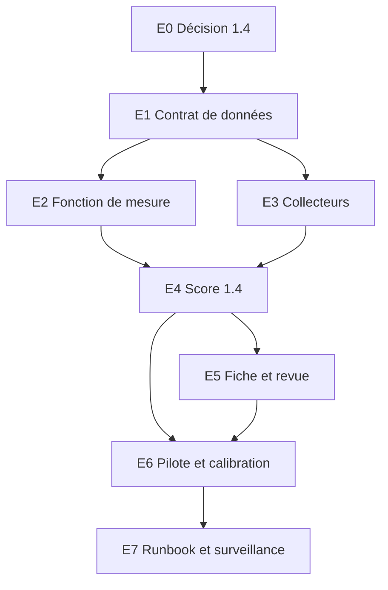

# Mesure de l'engagement — décision et plan de mise en œuvre

Version 1.0 · 16 novembre 2026 · critères **1.4**

Ce document applique le §5.3 du cadrage. Il fixe la mesure qui entre dans la
ligne d'engagement, puis décrit comment la produire, la stocker, la tester et la
mettre en service. Il ne réécrit pas le score : les poids, les formules et les
règles d'arrondi restent dans `docs/scope.md` (§3.5) et `docs/scoring.md`.

La ligne d'engagement vaut `25 × min(1 ; mesure ÷ abonnés ÷ seuil)`. Une seule
ligne s'applique : celle de la plateforme principale. On ne mélange jamais deux
plateformes, deux unités ou deux fenêtres.

---

## 1. Décision — cinq lignes

| Plateforme (seuil) | Mesure lue | Source | Fenêtre | Statistique | Donnée illisible |
|---|---|---|---|---|---|
| **Telegram** (20 %) | vues par publication ÷ abonnés | compteur de vues sous chaque publication | 30 jours, au plus 30 publications ; repli sur les 10 dernières dans les 90 jours | médiane | compteur masqué → inconnu, revue |
| **VK Video** (10 %) | vues par vidéo longue ÷ abonnés ; clips et directs exclus | compteur de vues de chaque vidéo | 30 jours, au plus 30 vidéos ; repli sur les 10 dernières dans les 90 jours | médiane | inconnu → revue ; chaîne uniquement en direct → revue |
| **Twitch** (5 %) | spectateurs simultanés moyens ÷ abonnés | statistiques des directs ou outil public de suivi | 10 derniers directs sur 60 jours | médiane | inconnu → revue ; **pas de repli sur les vues de rediffusion** |
| **Rutube** (5 %, provisoire) | vues par vidéo ÷ abonnés ; clips exclus | compteur de vues de chaque vidéo | 30 jours, au plus 30 vidéos ; repli sur les 10 dernières dans les 90 jours | médiane | inconnu → revue |
| **YouTube** (10 %, provisoire) | vues par vidéo longue ÷ abonnés ; formats courts exclus | compteur public de chaque vidéo | 30 jours, au plus 30 vidéos ; repli sur les 10 dernières dans les 180 jours | médiane | vues masquées ou restriction d'âge → revue |

### Règles de mesure

Règle **M-01 — une mesure par plateforme.** La mesure est celle de la plateforme
principale. Les profils secondaires ne sont ni additionnés ni comparés.

Règle **M-02 — médiane.** La statistique est la médiane, calculée exactement.
Pour un échantillon pair, c'est la moyenne des deux valeurs centrales ; elle peut
valoir ,5 et reste exacte jusqu'au calcul du score. Aucun arrondi intermédiaire.

Règle **M-03 — même instantané.** Les vues (ou les spectateurs simultanés) et les
abonnés sont lus dans le même instantané, avec un seul horodatage. Deux lectures
séparées ne forment pas un rapport.

Règle **M-04 — fenêtre de temps d'abord.** La fenêtre principale est de 30 jours,
plafonnée aux 30 éléments les plus récents. Si moins de 5 éléments sont lisibles,
on replie sur les 10 derniers dans la fenêtre de repli. La fenêtre réellement
utilisée est inscrite dans la fiche, avec son mode.

Règle **M-05 — échantillon minimum.** Il faut au moins 5 éléments lisibles. Entre
5 et 9, la mesure est calculée mais porte le drapeau `WEAK_SAMPLE`. En dessous de
5, elle est inconnue.

Règle **M-06 — exclusions.** Sont exclus de l'échantillon : les publications
épinglées, les publicités achetées, les clips et formats courts, et — hors Twitch
— les directs et rediffusions. Sur Twitch, le direct est l'unité mesurée ; les
rediffusions sont exclues.

Règle **M-07 — illisible n'est pas zéro.** Une donnée illisible rend la mesure
inconnue. Le critère est bloquant : la fiche part en revue. On n'estime pas, on
ne remplit pas avec la moyenne d'autres fiches, on ne change pas d'unité pour
sauver la mesure. Un zéro **mesuré** reste une mesure et vaut zéro point ; un
zéro **inconnu** n'existe pas.

Règle **M-08 — l'échantillon est conservé.** La fiche garde les éléments retenus
(URL, date, type, valeur, motif d'exclusion), la fenêtre, la taille de
l'échantillon et la date de lecture. Le calcul doit être rejouable sans relire la
plateforme.

Règle **M-09 — la moyenne est un diagnostic.** La moyenne est stockée à côté de
la médiane, pour l'audit seulement. Si elle dépasse le double de la médiane, la
fiche porte le drapeau `DISPERSION`. Les points ne changent pas.

Règle **M-10 — toute modification crée une version.** Un changement de mesure, de
fenêtre, de statistique ou de seuil crée une nouvelle version des critères. Les
scores existants ne sont pas reclassés automatiquement (V-03).

---

## 2. Entrée — l'échantillon

Un élément d'échantillon décrit une publication, une vidéo ou un direct :

| Champ | Contenu |
|---|---|
| `platform` | plateforme du profil |
| `item_url` | adresse publique de l'élément |
| `item_id` | identifiant stable si la plateforme en expose un |
| `item_kind` | `POST`, `LONG_VIDEO`, `SHORT`, `STREAM`, `VOD`, `CLIP` |
| `published_at` | date et heure de publication, en UTC |
| `value` | vues, ou spectateurs simultanés moyens pour un direct |
| `read_at` | date et heure de lecture, identique pour tout l'instantané |
| `readable` | le compteur a-t-il pu être lu ? |
| `exclusion_reason` | `PINNED`, `PAID_AD`, `CLIP`, `LIVE`, `UNREADABLE` |

Avec le profil : `followers`, `followers_read_at`, `main_platform`.

Un élément sans URL, sans date ou sans valeur n'entre pas dans l'échantillon : il
est compté comme illisible. Un élément exclu reste conservé, avec son motif. Un
élément structurellement exclu peut aussi être illisible : `readable=false`
porte l'illisibilité, `exclusion_reason` porte la cause structurelle.

---

## 3. Sortie — la mesure

Le résultat de la mesure contient :

| Champ | Contenu |
|---|---|
| `status` | `MEASURED` ou `UNKNOWN` |
| `measure_kind` | `VIEWS_PER_ITEM` ou `CONCURRENT_VIEWERS` |
| `statistic` | `MEDIAN` |
| `value` | médiane exacte, en vues ou en spectateurs simultanés |
| `sample_size` | éléments lisibles retenus |
| `unreadable_count` | éléments illisibles dans la fenêtre |
| `window_start` / `window_end` | bornes réellement utilisées |
| `window_mode` | `TIME` ou `FALLBACK` |
| `flags` | `WEAK_SAMPLE`, `WINDOW_EXTENDED`, `DISPERSION`, `UNREADABLE` |
| `read_at` | instantané de lecture |
| `sample_hash` | empreinte des éléments retenus |
| `reason` | diagnostic quand la mesure est inconnue (`sample_too_small`, `mostly_unreadable`, `snapshot_mismatch`, `empty_sample`, `platform_without_policy`) ; jamais un critère |

Le résultat ne contient ni le ratio ni les points : le score les calcule. Cette
séparation permet de tester la mesure sans tester le barème.

En `UNKNOWN`, le résultat conserve la fenêtre tentée, la taille de l'échantillon
et le nombre d'illisibles pour le journal de mesure ; la fiche ne publie ces
champs que lorsque la mesure est `MEASURED` (E1). Le champ `reason` est un
diagnostic interne, jamais un critère.

---

## 4. Algorithme

1. **Vérifier l'instantané** : `followers_read_at` et `read_at` portent le même
   horodatage. Sinon, la mesure est inconnue.
2. **Filtrer les types** : garder les types admis par la plateforme — publications
   pour Telegram, vidéos longues pour VK Video, Rutube et YouTube, directs pour
   Twitch. Un type absent de la politique est exclu, pas converti.
3. **Exclure** les épinglés, publicités achetées, clips, formats courts, directs
   et rediffusions selon M-06.
4. **Sélectionner la fenêtre principale** : 30 × 24 heures avant l'instantané,
   au plus 30 éléments les plus récents. Pour Twitch : les 10 derniers directs
   dans 60 jours.
5. **Compter les illisibles** dans la fenêtre. Si plus de la moitié des éléments
   candidats sont illisibles, la mesure est inconnue.
6. **Appliquer le repli** si moins de 5 éléments sont lisibles : 10 derniers dans
   90 jours (180 pour YouTube), 10 derniers directs dans 60 jours pour Twitch.
7. **Calculer la médiane** sur les valeurs lisibles. Échantillon impair : valeur
   centrale. Échantillon pair : moyenne exacte des deux valeurs centrales.
8. **Poser les drapeaux** : `WEAK_SAMPLE` si 5 à 9 éléments, `WINDOW_EXTENDED` si
   le repli a servi, `DISPERSION` si la moyenne dépasse le double de la médiane.
9. **Écrire le résultat et l'échantillon** : fenêtre réelle, taille, illisibles,
   date de lecture, empreinte.

Une fenêtre vide, un type interdit partout, ou un compteur masqué sur plus de la
moitié des éléments donnent `UNKNOWN`. `UNKNOWN` n'est jamais zéro.

---

## 5. Cas d'essai

Ces cas testent la mesure. Les cas V1 à V14 de `docs/scoring.md` testent les
points.

| # | Entrée | Attendu |
|---|---|---|
| M1 | Telegram, 100 000 abonnés, 30 publications : 29 à 12 000 vues, 1 à 900 000 | médiane 12 000 → 12 % → 15 points ; la moyenne 41 600 (41,6 %, 25 points) est refusée |
| M2 | Twitch, 100 000 abonnés, 10 directs, médiane 1 200 simultanés | 1,2 % → 6 points ; 30 000 vues de rediffusion (30 %, 25 points) sont refusées |
| M3 | Telegram, 4 publications lisibles | inconnu, bloquant, revue |
| M4 | Telegram, 8 publications dont 2 illisibles | médiane sur 6, `unreadable_count = 2` |
| M5 | YouTube, 3 vidéos sur 30 jours, 10 sur 180 jours | repli sur 10, `window_mode = FALLBACK`, drapeau `WINDOW_EXTENDED` |
| M6 | Échantillon pair : les deux valeurs centrales sont 10 000 et 14 000 | médiane 12 000, exacte |
| M7 | VK Video, chaîne uniquement en direct | inconnu, bloquant, revue |
| M8 | Plus de la moitié des éléments sont illisibles | inconnu, bloquant, revue |
| M9 | VK Video : 20 vidéos longues à 8 000 vues et 1 clip à 800 000 | clip exclu, médiane 8 000 |
| M10 | Telegram : 30 publications dont une épinglée à 500 000 | épinglée exclue, médiane sur les autres |

---

## 6. Modèle de données

### 6.1 Fiche Baserow

Champs ajoutés à `Createurs` et à `Profils_plateforme` :

| Champ | Type | Obligatoire | Rôle |
|---|---|---|---|
| `engagement_status` | single_select | oui | `MEASURED` / `UNKNOWN` |
| `engagement_measure` | single_select | conditionnel | `VIEWS_PER_ITEM` / `CONCURRENT_VIEWERS` |
| `engagement_statistic` | single_select | conditionnel | `MEDIAN` |
| `engagement_value` | number | conditionnel | médiane exacte |
| `engagement_sample_size` | number | conditionnel | éléments lisibles retenus |
| `engagement_unreadable_count` | number | non | éléments illisibles |
| `engagement_window` | text | conditionnel | bornes et mode de fenêtre |
| `engagement_read_at` | date_time | conditionnel | instantané de lecture |
| `engagement_sample_ref` | long_text | non | échantillon conservé ou référence PostgreSQL |
| `engagement_flag` | multiple_select | non | `WEAK_SAMPLE`, `WINDOW_EXTENDED`, `DISPERSION`, `UNREADABLE` |

`conditionnel` signifie : obligatoire quand `engagement_status = MEASURED`, vide
quand il vaut `UNKNOWN`. Le service de synchronisation applique la condition ;
Baserow ne sait pas l'exprimer au niveau du champ.

`average_views` et `average_concurrent_viewers` restent dans la fiche comme
moyennes de diagnostic. Elles ne rapportent aucun point.

### 6.2 PostgreSQL

| Table | Rôle | Historique |
|---|---|---|
| `creator_metric_sample` | un élément daté par publication, vidéo ou direct | append-only |
| `engagement_measure_run` | médiane, fenêtre, taille, drapeaux, hash | append-only |

`creator_metric_sample` porte le compte de plateforme, le type d'élément, l'URL,
la date de publication, la valeur, la date de lecture, le motif d'exclusion et le
snapshot de source.

`engagement_measure_run` porte le compte, la version des critères, la statistique,
les bornes de fenêtre, le mode, la taille, les illisibles, la valeur, les drapeaux,
la date de calcul et le hash de l'échantillon.

Un résultat `UNKNOWN` pour une plateforme hors politique n'a pas de
`measure_kind` : il ne produit pas de ligne `engagement_measure_run`. Les autres
`UNKNOWN` en produisent une, avec leur fenêtre tentée, leurs compteurs et leur
hash.

`score_line` référence `engagement_measure_run` pour la ligne d'engagement. Le
calcul des points ne relit jamais l'échantillon ; il reçoit la médiane.

### 6.3 Migration

- Les fiches existantes reçoivent `engagement_status = UNKNOWN` ; les autres
  champs d'engagement restent vides.
- Aucune moyenne existante n'est convertie en médiane. Une fiche sans échantillon
  ne peut pas être rejouée en 1.4 ; elle garde son score 1.3 jusqu'à recollecte.
- La migration ne reclasse aucune fiche (V-03).

---

## 7. Plan de mise en œuvre

| Phase | Contenu | Livrable vérifiable | Responsable | Dépend de |
|---|---|---|---|---|
| **E0** | Signer la décision, passer les critères en 1.4, figer M1 à M10 | cadrage 1.4 signé, cinq lignes au §5.3 | Superviseur + Intern 2 | — |
| **E1** | Contrat de données : champs Baserow, tables PostgreSQL, migration, tests de contrat | schéma à jour, migration à blanc, tests verts | Intern 3 | E0 |
| **E2** | Fonction pure de mesure : sélection, exclusions, médiane, drapeaux | module et tests M1 à M10 | Intern 3 | E1 |
| **E3** | Collecteurs : Telegram, VK Video, Rutube, YouTube, Twitch | 10 créateurs par plateforme recomputés à la main | Intern 1 + Intern 3 | E1 |
| **E4** | Branchement dans le score, seuils 1.4, cas V1 à V14 | score 1.4 identique au calcul manuel | Intern 3 | E2, E3 |
| **E5** | Fiche et file de revue : affichage, drapeaux, recalcul | une fiche auditable sans relire la plateforme | Intern 2 | E4 |
| **E6** | Pilote de 30 à 50 créateurs par plateforme, calibration Rutube et YouTube | rapport de distribution, décision de seuil | Superviseur + tous | E4, E5 |
| **E7** | Runbook, surveillance, passation | documentation et alertes en place | Intern 3 + Intern 2 | E6 |

E2 est fait : la fonction pure de mesure et les cas M1 à M10 sont écrits et
passent (`processing/engagement.py`, `tests/test_engagement.py`). Les étapes E1
(contrat de données) et E3 (collecteurs) restent à faire, donc la mesure n'est
pas encore alimentée par de vraies lectures.

Jalons indicatifs, alignés sur le calendrier du cadrage : E0 et E1 avant la
semaine 5 (premiers scores) ; E2 et E3 avant P1 ; E4 et E5 avant le pilote de la
semaine 8 ; E6 pendant le pilote ; E7 avant la clôture.

État au 16 novembre 2026 : **E0 à E4 sont appliqués côté code**. La recette
manuelle de 10 créateurs par plateforme reste à exécuter ; E5 à E7 restent à
faire.

### E0 — Décision

- appliquer le §5.3, la règle C-03, le §5.5, le §11, le §12 et le §14 du cadrage ;
- aligner `docs/scoring.md` sur la médiane et les seuils 1.4 ;
- figer les cas M1 à M10 et les seuils provisoires ;
- aucune ligne de code.

### E1 — Contrat de données

- ajouter les champs à `db/baserow/schema.json` et aux tests de contrat ;
- créer `creator_metric_sample` et `engagement_measure_run` ;
- écrire la migration `engagement_status = UNKNOWN` pour l'existant ;
- définir la forme JSON de `engagement_sample_ref` ;
- vérifier la création des tables en `--dry-run`, sans réseau.

### E2 — Fonction pure de mesure

- créer `processing/engagement.py` ;
- fonctions pures, sans réseau, sans horloge : l'instantané est porté par
  `followers_read_at` et `read_at` ;
- médiane exacte avec `Fraction`, sans arrondi intermédiaire ;
- tests M1 à M10, plus un test d'échantillon vide et un test de type interdit ;
- aucun accès à la base dans cette étape.

### E3 — Collecteurs

| Plateforme | À lire | Piège à couvrir |
|---|---|---|
| Telegram | vues sous chaque publication, date, épinglé | distinguer épinglé et publicité |
| VK Video | vues des vidéos longues, date | exclure clips et directs |
| Rutube | vues des vidéos, date | exclure clips |
| YouTube | vues des vidéos longues, date | reconnaître les formats courts |
| Twitch | spectateurs simultanés moyens par direct | ne pas lire les vues de rediffusion |

Chaque collecteur rend des éléments bruts, pas une mesure. La mesure est calculée
par la fonction d'E2. Pour chaque plateforme, 10 créateurs sont recomputés à la
main ; les cas illisibles sont documentés, pas contournés. Les abonnés ne sont
pas collectés ici : ils viennent de la fiche de profil et sont lus au même
instantané.

La traduction est faite par `integrations/engagement_collectors.py` :

- une seule normalisation par plateforme, aucun identifiant d'Actor codé en dur ;
- l'opérateur fournit l'Actor et son entrée ; le module fournit la traduction ;
- contrat minimum d'une ligne : une URL publique, une date de publication, une
  valeur ; sur Twitch, la valeur est la simultanéité, jamais les vues de
  rediffusion ;
- une ligne sans URL ou sans date est écartée et comptée ; une ligne sans valeur
  lisible devient un élément illisible, jamais un zéro ;
- `collect_with_apify()` rend les identifiants du run et du dataset, pour que la
  preuve reste rattachable à la collecte ;
- recette manuelle : 10 créateurs par plateforme, médiane recalculée à la main
  depuis les lignes, écart consigné. Un écart bloque la plateforme.

### E4 — Score

- `apply_engagement_measure` reporte la médiane, l'échantillon, l'instantané, le
  type, les drapeaux et la référence du run ; une mesure `UNKNOWN` efface la
  médiane ;
- le type de mesure est contrôlé par plateforme : `VIEWS_PER_ITEM` partout,
  `CONCURRENT_VIEWERS` sur Twitch ; un mélange rend la ligne inconnue ;
- le seuil dépend de la plateforme : 20, 10, 5, 5, 10 ;
- la ligne d'engagement référence `engagement_measure_run` (`measure_ref`, puis
  `engagement_measure_run_id` dans `to_score_lines()`) ;
- les cas V1 à V14 et M1 à M10 passent ;
- la frontière 69,875 / 70 ne bouge pas.

### E5 — Fiche et revue

- afficher la mesure, l'unité, la fenêtre, la statistique, la taille, les
  illisibles, la date de lecture et les drapeaux ;
- ajouter une file « engagement à revoir » pour `UNKNOWN` et `WEAK_SAMPLE` ;
- permettre à un relecteur de recalculer la médiane depuis l'échantillon ;
- signaler `DISPERSION` à l'audit, sans changer les points.

### E6 — Pilote et calibration

- 30 à 50 créateurs par plateforme, dont 10 par plateforme déjà relus à la main ;
- mesurer le taux d'inconnus, la distribution des rapports et le taux de
  `WEAK_SAMPLE` ;
- calibrer les seuils Rutube et YouTube : garder 5 % et 10 %, ou créer la 1.5 ;
- ne jamais modifier un seuil en place : nouvelle version, rejeu explicite.

### E7 — Runbook et surveillance

- documenter la collecte, les exclusions et les cas illisibles ;
- alerter si le taux d'engagement inconnu dépasse 20 % sur une plateforme ;
- alerter si un collecteur rend moins de 5 éléments sur plus de 20 % des fiches ;
- mettre à jour la passation entre stagiaires (§12 du cadrage).

---

## 8. Critères d'acceptation

- La médiane se recalcule depuis l'échantillon stocké, sans relire la plateforme.
- M1 à M10 passent, dont le refus de la moyenne, le repli de fenêtre et les
  exclusions.
- Une mesure inconnue ne produit jamais une ligne à zéro et bloque la
  présélection.
- Deux exécutions sur le même instantané donnent la même valeur, octet pour octet.
- Aucune mesure ne mélange vues et spectateurs simultanés, ni directs et
  rediffusions.
- Les scores 1.3 restent lisibles ; aucun n'est reclassé automatiquement en 1.4.
- Les seuils Rutube et YouTube sont marqués provisoires et versionnés.
- La fiche permet à un relecteur de refaire le calcul sans ouvrir la plateforme.

---

## 9. Risques

| Risque | Effet | Réduction |
|---|---|---|
| Le collecteur ne rend pas les dates de publication | la fenêtre n'est pas vérifiable | refuser la mesure ; ne pas déduire la date du numéro d'ordre |
| Twitch ne donne pas les simultanés historiques | l'engagement Twitch tombe en revue | assumer le volume ; ne pas basculer sur les vues de rediffusion |
| Les publicités Telegram sont difficiles à distinguer | l'échantillon mélange organique et payant | exclure seulement les publicités confirmées, conserver le motif |
| YouTube change la définition des formats courts | le type d'élément devient faux | stocker `item_kind` et le vérifier au moment de la lecture |
| Un échantillon pair donne une médiane à ,5 | affichage ambigu | conserver la valeur exacte, arrondir seulement à l'affichage |
| Les fiches 1.3 n'ont pas d'échantillon | impossible de rejouer en 1.4 | recollecte planifiée ; conserver le score 1.3 en attendant |
| Le pilote montre que 5 % ou 10 % saturent | tout le monde au plafond | ajuster en 1.5, avec rejeu explicite |

---

## 10. Points ouverts

1. **VK Video Live seul** : un créateur uniquement en direct n'a pas de vues de
   vidéos. La 1.4 le laisse en engagement inconnu, donc en revue. Faut-il un seuil
   séparé sur les spectateurs simultanés ?
2. **Calibration Rutube et YouTube** : 5 % et 10 % sont provisoires. Le pilote
   tranche.
3. **Détection des publicités Telegram** : quel signal fait foi — étiquette, erid,
   mention de l'annonceur, ou les trois ?
4. **Détection des formats courts YouTube** : durée, orientation, ou les deux ?
   La définition de la plateforme peut changer.
5. **Source des simultanés Twitch** : statistiques de la plateforme ou outil
   public de suivi, selon l'accès réellement disponible.
6. **Seuil de l'échantillon faible** : 5 est le plancher ; faut-il exiger 10 pour
   les plateformes qui publient beaucoup ?

---

## 11. Compatibilité avec la version 1.3

La 1.3 ne fixait que le calcul des points ; elle ne dit pas comment produire la
mesure. La 1.4 ajoute cette étape et les seuils Rutube et YouTube. Elle ne change
ni les poids, ni les formules, ni le seuil de 70.

Un score 1.3 reste valable pour la fiche qui le porte. Il n'est pas recalculé en
1.4 sans un échantillon daté. La décision de rejouer est explicite, tracée, et
documentée (V-03). Une moyenne 1.3 ne devient jamais une médiane 1.4 par
conversion : c'est une nouvelle lecture, avec ses éléments.
